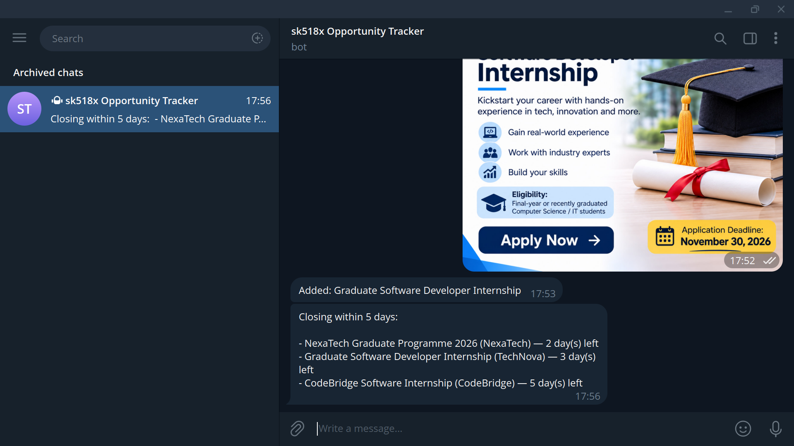
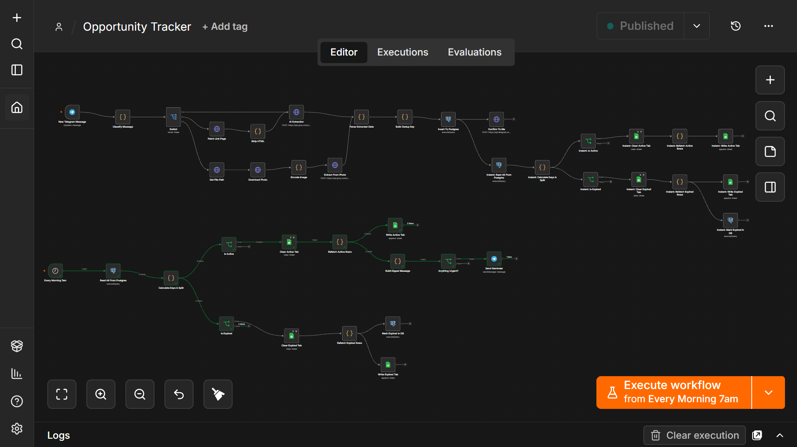

# Opportunity Tracker

An automated pipeline that turns messy, scattered bursary, internship, and graduate programme posts shared across WhatsApp, Facebook, and LinkedIn into a clean, deduplicated, always-up-to-date database - with zero manual data entry.

Forward a post to a Telegram bot → AI extracts the structured details → the information is saved to a PostgreSQL database and a live Google Sheet, automatically organised by closing date.

Designed to run independently of any personal device using free-tier cloud infrastructure.

---

## Demo

Watch a demonstration of the Opportunity Tracker:

[▶ Watch the project demo](https://youtu.be/PnwTr8FDFnE)

The demo shows the complete workflow, from submitting an opportunity through Telegram to saving it in Google Sheets and receiving deadline notifications.

---

## Why I Built This

Opportunities like these are shared constantly across group chats and social media posts. Each comes in a different format, has different deadlines, and rarely has a central place where everything can be tracked.

Missing a deadline usually isn't a lack of interest - it's a post that got buried in a chat history.

This project removes the manual tracking step entirely: see a post, forward it, done.

---

## Features

- **Multi-format intake:** Accepts plain text, links (automatically fetches and reads the page), and photos/screenshots (vision-model extraction).
- **AI-powered structured extraction:** Extracts the title, organisation, opportunity type, deadline, application link, and eligibility requirements from unstructured text and images.
- **Automatic deduplication:** The same opportunity forwarded twice is silently ignored, enforced at the database level.
- **Live, sorted view:** A Google Sheet that always reflects the database, split into Active and Expired tabs, with automatically calculated days remaining.
- **Proactive reminders:** A daily digest of opportunities closing within five days, delivered directly to Telegram.
- **Zero ongoing cost:** Every component runs on a genuinely free tier, with no credit card required anywhere in the stack.

---

## Architecture

### 1. Opportunity Intake

```text
┌─────────────────────────────────────────────────────────────┐
│                         INTAKE                              │
│                                                             │
│  Telegram message                                           │
│       ↓                                                     │
│  Classify (text / link / photo)                             │
│       ↓                                                     │
│  Extract via Groq AI                                         │
│       ↓                                                     │
│  Parse and validate                                          │
│       ↓                                                     │
│  Check for duplicates                                        │
│       ↓                                                     │
│  Insert into PostgreSQL                                      │
│       ↓                                                     │
│  Confirmation reply + instant Google Sheets sync            │
└─────────────────────────────────────────────────────────────┘
```

### 2. Daily Synchronisation

```text
┌─────────────────────────────────────────────────────────────┐
│                  DAILY SYNC (7 AM)                          │
│                                                             │
│  Read PostgreSQL records                                     │
│       ↓                                                     │
│  Calculate days remaining                                    │
│       ↓                                                     │
│  Split into Active / Expired                                │
│       ↓                                                     │
│  Rebuild both Google Sheets tabs                             │
│       ↓                                                     │
│  Send a digest if anything is closing soon                   │
└─────────────────────────────────────────────────────────────┘
```

For the complete architecture, node-by-node reference, and troubleshooting notes, see [documentation.md](docs/documentation.md).

---

## Tech Stack

| Layer | Technology |
|---|---|
| Automation / Orchestration | n8n (self-hosted) |
| Hosting | Render (free tier) |
| Database | PostgreSQL via Neon (free tier) |
| AI Extraction (Text + Vision) | Groq – Qwen 3.8 27B |
| Messaging Interface | Telegram Bot API |
| Live Spreadsheet View | Google Sheets API |

---

## Key Design Decisions

### 1. Database-First Architecture

PostgreSQL is the source of truth, while Google Sheets acts as a presentation layer that gets rebuilt from the database on every synchronisation.

This means the presentation layer can change or break without putting the underlying data at risk.

### 2. Database-Level Deduplication

Duplicate detection is enforced at the schema level rather than relying on application logic.

A `UNIQUE` constraint on a normalised title + organisation key, combined with `ON CONFLICT DO NOTHING` during insertion, prevents duplicate records without requiring a manual preliminary check.

### 3. Two Independent Synchronisation Chains

Two parallel synchronisation chains handle different responsibilities:

- **Instant sync:** Triggered when a new opportunity is added.
- **Scheduled sync:** Runs daily to update statuses, calculate remaining days, rebuild the Sheet, and send reminders.

This allows immediate updates without duplicating reminder logic for every incoming message.

### 4. Defensive AI Output Handling

The AI response is stripped of reasoning text, parsed, and validated against the allowed opportunity types before reaching the database.

Unexpected responses are handled gracefully rather than causing failed database inserts.

---

## Error Handling

The system includes several defensive mechanisms to handle unexpected behaviour.

| Scenario | How It Is Handled |
|---|---|
| Messy AI output | Reasoning text is stripped, and JSON is extracted from surrounding prose before parsing. If parsing still fails, a fallback row titled `Could not parse - check manually` is saved with the first 200 characters of the raw response. |
| Unexpected categories | Any opportunity type outside the allowed list is converted to `Other` before insertion, preventing database constraint violations. |
| Duplicate opportunities | Rejected by a database `UNIQUE` constraint with `ON CONFLICT DO NOTHING`. No error or second row is generated. |
| Missing deadlines | Stored as `NULL` and displayed as `no date` rather than causing an insertion failure. |
| Partial or failed Sheet writes | Google Sheets is rebuilt from PostgreSQL during every synchronisation, correcting inconsistent states on the next run. |
| API rate limits | Sheet-clearing steps run once per execution instead of once per row, reducing unnecessary Google API requests. |
| Observability | Every workflow execution is logged in n8n's Executions view, allowing individual nodes and failures to be inspected. |

Failures are visible in the execution logs, but automatic failure notifications have not yet been implemented (see Future Improvements).

---

## Known Limitations

The following limitations are currently known:

1. **Single-user access:** The bot is restricted to the configured Telegram chat ID. Messages from other chats are ignored.

2. **Silent outcomes:** Duplicate submissions receive no reply. Failed executions also produce no reply, making the two scenarios difficult to distinguish without checking the n8n Executions log.

3. **Fallback row deduplication:** Only one unparseable post can be stored at a time because fallback rows share the same deduplication key.

4. **Unsupported message types:** Videos without captions, voice notes, and files are treated as empty text and sent to the AI anyway.

5. **Photo handling:** Photo captions are ignored, and each message produces at most one opportunity.

6. **Limited link reading:** Only messages consisting entirely of a URL are fetched. Only the first 3,000 characters of page text are processed. Login-protected and JavaScript-rendered pages may return little or no useful content.

7. **Missing deadlines:** Opportunities without deadlines never expire.

8. **One-way status synchronisation:** Editing an opportunity's status directly in Google Sheets does not update PostgreSQL. The next synchronisation overwrites the change.

9. **Free-tier hosting limitations:** Hosting may sleep when idle. The first message after a quiet period can take longer to process, and the scheduled 7 AM digest only runs if the service is awake.

10. **Concurrent synchronisations:** Rapid-fire messages can briefly cause overlapping Sheet rebuilds. The next synchronisation corrects the resulting state.

11. **AI model lifecycle:** Models can be retired by the provider. This has already happened several times during the project.

---

## Future Improvements

### 1. Security and Reliability

- Implement an n8n error workflow that sends a Telegram notification whenever an execution fails.
- Reply with `Already tracked` when a duplicate opportunity is submitted.
- Provide clear feedback when extraction fails.
- Implement a free keep-alive ping to improve the reliability of the daily digest.
- Add retry mechanisms with exponential backoff for AI and Google API calls.
- Make fallback rows unique and flag them for manual review in Google Sheets.
- Store the AI model name in one central location and implement a startup health check to detect retired models early.
- Move the Telegram bot token out of raw request URLs and into an n8n credential.

### 2. Usability

- Add Telegram bot commands such as `/done`, `/list`, and `/delete` that update PostgreSQL directly, eliminating the need for manual SQL queries.
- Provide helpful responses to unsupported message types.
- Use photo captions as additional extraction context.
- Introduce deadline reminders at 7, 3, and 1 days before closing, alongside a weekly summary.
- Add calendar (`.ics`) export functionality for upcoming deadlines.

### 3. Architecture and Scalability

- Implement two-way status synchronisation between Google Sheets and PostgreSQL.
- Introduce an authenticated, read-only web dashboard (prototyped during early development but not included in the current version).
- Add multi-user support, with opportunities scoped to individual Telegram chats.

---

## What I Learned

Building this project involved solving several practical problems across automation, APIs, databases, AI integration, and deployment.

Some of the most valuable lessons included:

- **OAuth and authentication:** Configuring multi-step Google OAuth authentication for a self-hosted application, including Google Cloud Console credentials, consent screens, and test users. I also learned why applications left in `Testing` mode have refresh tokens that expire after seven days.

- **Workflow debugging:** Diagnosing silent failures in a visual automation tool by tracing exactly where data breaks in a pipeline, using execution logs rather than guesswork.

- **AI model lifecycle management:** Managing model retirements by the provider. The models originally used by this project were retired in sequence, both during development and months after completion, requiring live replacements.

- **API rate limits:** Understanding how nodes that execute once per item can generate dozens of requests against rate-limited APIs. This was resolved by ensuring the Sheet-clearing operation runs once per execution.

- **Memory-constrained hosting:** Tuning a Node.js process to run reliably within a 512 MB free-tier container.

- **Workflow publishing:** Understanding the practical difference between a workflow's saved state and published state, and how the gap can introduce silent staleness bugs.

- **Credential management:** Keeping secrets out of exported workflow files and discovering that hardcoded values in raw HTTP request URLs are not stripped during export in the same way as stored credentials.

---

## Repository Structure

```text
opportunity-tracker/
│
├── README.md
├── architecture-diagram.svg
├── schema.sql                      # PostgreSQL schema
├── .env.example                    # Required credentials and config
│
├── docs/
│   └── documentation.md            # Architecture, node reference,
│                                   # and troubleshooting
│
├── workflow/
│   └── Opportunity_Tracker.json    # Exported n8n workflow
│                                   # (credentials not included)
│
└── screenshots/
```

---

## Setup

### Running Your Own Copy

This is not a one-click deployment. It is a workflow that you would rebuild using your own n8n instance.

The general setup process is as follows:

1. **Create the required free accounts:**
   - Render
   - Neon
   - Groq
   - Telegram bot via BotFather
   - Google Cloud project (Google Sheets API + OAuth credentials)

2. **Deploy n8n to Render** using the official Docker image, connected to your Neon PostgreSQL instance.

3. **Create the opportunities table** using [schema.sql](schema.sql).

4. **Import the n8n workflow** from `workflow/Opportunity_Tracker.json` and reconnect all credentials. No credentials are included in the exported workflow.

5. **Replace all placeholder values**, including:
   - Telegram bot token
   - Google Spreadsheet ID
   - Your Telegram chat ID

   Use `.env.example` as a configuration checklist.

6. **Publish the workflow** so that the Telegram trigger registers its webhook.

For detailed setup instructions, see [documentation.md](docs/documentation.md).

---

## Screenshots

### Telegram Bot


### Google Sheets


### n8n Workflow


---

## License

MIT License - feel free to adapt this project for your own use case.
