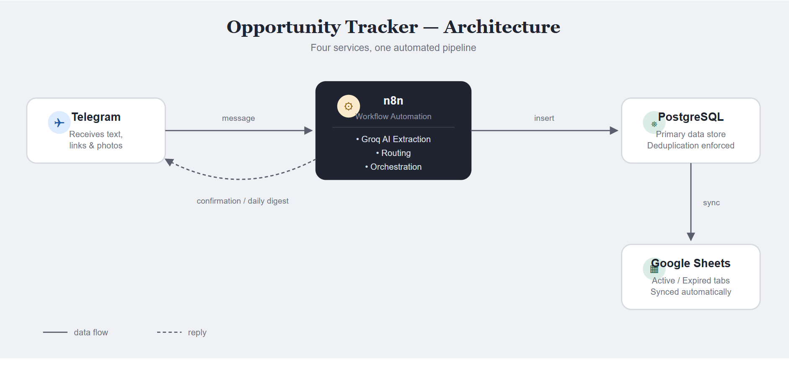
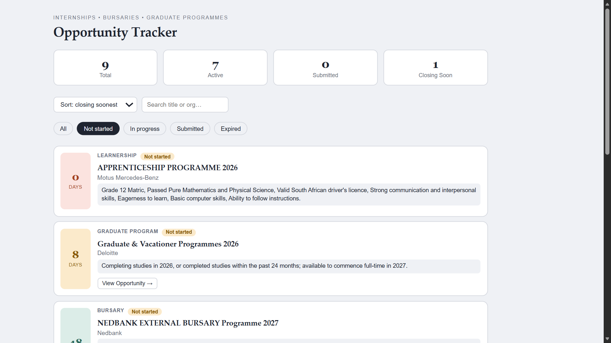
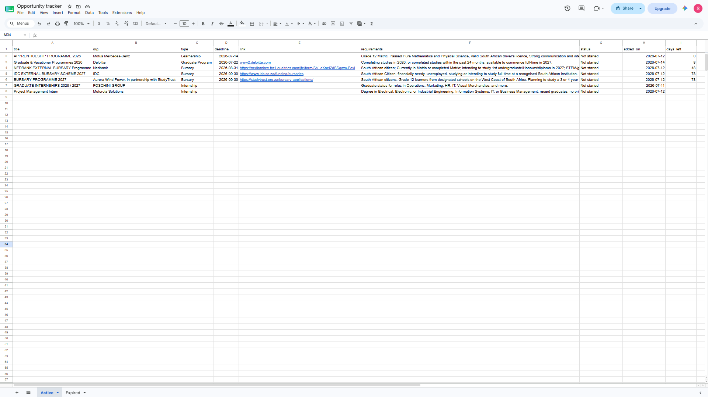
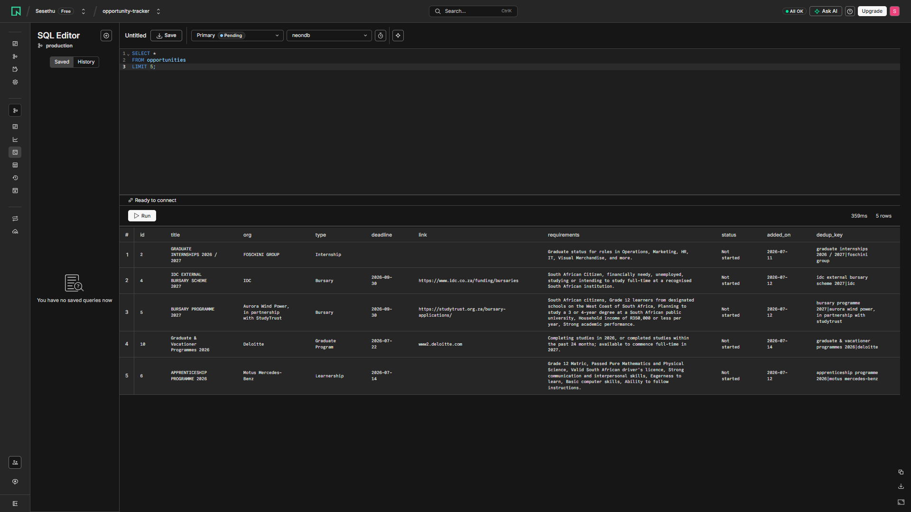

# Opportunity Tracker

An automated pipeline that collects bursary, internship and graduate programme opportunities shared across WhatsApp, Facebook and LinkedIn, then organizes them into a PostgreSQL database, Google Sheets tracker and web dashboard.

Forward a post to a Telegram bot → AI extracts the important details → n8n stores them in PostgreSQL and automatically updates Google Sheets and the dashboard.

Runs entirely on free-tier cloud services and requires no manual data entry once configured.

---

## Why I built this

Opportunities are often shared across WhatsApp groups and social media in different formats, making them easy to lose track of. Missing a deadline usually isn't because the opportunity wasn't interesting—it simply got buried in chat history.

This project automates the collection process so that forwarding a post is enough to keep everything organized.

---

## What it does

- **Accepts multiple formats** — plain text, links and images.
- **Extracts structured information** — AI identifies the title, organisation, type, deadline, application link and requirements.
- **Prevents duplicates** — repeated opportunities are ignored using a unique database key.
- **Keeps everything synchronized** — PostgreSQL, Google Sheets and the dashboard always show the latest data.
- **Sends reminders** — opportunities closing within five days are sent to Telegram automatically.
- **Runs on free-tier services** — no paid infrastructure is required.

---

## Architecture

<p align="center">
  
</p>

For a detailed explanation of each workflow, see [`docs/documentation.md`](docs/documentation.md).

---

## Tech Stack

| Layer | Technology |
|-------|------------|
| Automation | n8n (self-hosted) |
| Hosting | Render |
| Database | PostgreSQL (Neon) |
| AI | Groq |
| Messaging | Telegram Bot API |
| Spreadsheet | Google Sheets API |
| Dashboard | HTML, CSS and JavaScript |

---

## Key design decisions

- **PostgreSQL is the primary data store.** Google Sheets is a synchronized view rather than the main database.
- **Duplicate prevention is handled by the database** using a unique key together with `ON CONFLICT DO NOTHING`.
- **Separate workflows** handle instant synchronization and daily reminder messages independently.

---

## What I learned

- Setting up OAuth credentials for the Google Sheets API.
- Building and debugging multi-step workflows in n8n.
- Deploying n8n on a free cloud service.
- Working with PostgreSQL, REST APIs and webhooks.
- Handling CORS for a browser-based dashboard.

---

## Project Structure

```text
Opportunity-Tracker/
│
├── README.md
├── LICENSE
│
├── assets/
│   └── architecture.png
│
├── dashboard/
│   └── opportunity_dashboard.html
│
├── database/
│   └── schema.sql
│
├── docs/
│   └── documentation.md
│
├── screenshots/
│   ├── dashboard.png
│   ├── google-sheets.png
│   ├── n8n-workflow.png
│   ├── postgresql.png
│   └── telegram.png
│
└── workflow/
    └── n8n-workflow-export.json
```

---

## Setup

This project requires configuring a few free services before it can run.

1. Create free accounts for:
   - Render
   - Neon
   - Groq
   - Telegram Bot (BotFather)
   - Google Cloud (Sheets API + OAuth)

2. Deploy n8n on Render.

3. Create the PostgreSQL database using `database/schema.sql`.

4. Import the workflow from:

   ```
   workflow/n8n-workflow-export.json
   ```

5. Reconnect your credentials (none are included in this repository).

6. Update your API keys, Telegram bot token and Google Sheet ID.

7. Update the dashboard webhook URL if deploying your own copy.

Detailed setup instructions are available in [`docs/documentation.md`](docs/documentation.md).

---

## Screenshots

### Dashboard



### n8n Workflow


### Google Sheets



### PostgreSQL



### Telegram Bot


---

## Future Improvements

Some ideas for future versions include:

- Support for additional opportunity sources.
- More dashboard filters and search options.
- Email notifications alongside Telegram reminders.
- User authentication for managing opportunities.
- Basic analytics and reporting.

